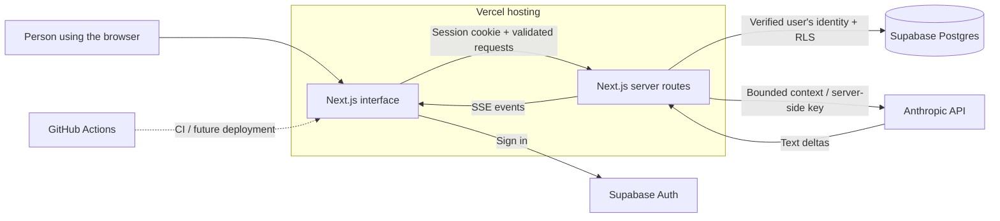

# Architecture

Status: preparation baseline, October 30, 2026. Decisions below are proposed
defaults for team review. The starter runs, but product features are not yet
implemented and the SQL migration has not been applied.

## Product boundary

Serve adults who recently moved to a city or started a program and want help
building local connections. Start with text conversations, an editable memory
panel, and one suggested social action that the person chooses. The app is
nonclinical and should encourage human relationships and independence.

Two initial conversation scenarios are `check_in` and `social_step`. Additional
scenarios, a product name, visuals, and model choice remain team decisions.
Optional dictation later turns speech into editable text before the user sends
it. Phone calls, live event scraping, and autonomous messages to other people
are outside the initial scope. Tavus is being prepared for optional audio-only
replies. User camera capture and video conversations are outside scope. The
cute, whimsical animal/creature mascot idea is deferred while architecture is built.

Deepgram is selected for optional dictation; Vapi was dropped on October 31.
The disabled provider/session ports,
transcript adapter, draft buffer, and server configuration are prepared; actual
capture and session transport are not implemented. The [voice architecture](voice.md)
keeps user-reviewed transcription separate from the app's Anthropic conversation
flow. The separate [Tavus audio-output architecture](tavus.md) prepares private
audio-only sessions and supplied-text Echo playback so the app/Claude remains
responsible for the answer. Combined mode compatibility and live REST/RTC
transport remain unverified/unimplemented. Both integrations default to disabled.
Gemini is deferred until credits are available. Mascot design still waits on
the collaborator-led image-generation workflow.

## System shape

Use one Next.js application, deployed on Vercel. Keep the interface, API, and
server orchestration in this repository, with clear modules. A separate backend,
queue, agent framework, ORM, or vector database is unnecessary for the first flow.

The browser never receives the Anthropic key or management tokens. It may receive
the Supabase URL and publishable key. Those identify the application; verified
user sessions, database grants, and RLS determine access to rows.

## Code boundaries

| Module | Responsibility | Must not do |
| --- | --- | --- |
| `src/app` and future components | Present data, capture choices, render streamed text | Decide record ownership or call Anthropic from the browser |
| Route Handlers | Verify session, validate input, call a feature service, return safe errors | Trust client-supplied user IDs or fabricated message history |
| Future feature services | Orchestrate chat, approval, expiry, and social-action transitions | Treat model suggestions as user consent |
| Future repositories | User-scoped database access and DTO mapping | Bypass RLS using a management or service-role key |
| `src/lib/anthropic` | Anthropic client and future streaming adapter | Write memories or contact people autonomously |
| `src/lib/contracts` | Pure schemas and stream shapes shared with UI | Import cookies, provider clients, or secrets |
| `src/lib/domain` | Interfaces between model, context, and boundary policy | Pretend these interfaces are finished implementations |

Use Node.js Route Handlers for model calls. Browser interactions become Client
Components only where needed; other pages/layouts can remain Server Components.
Return private user data with no shared response caching. Do not put personal
information in public static page data, metadata, or logs.

## Identity and authorization

Use Supabase Auth. Verify identity with `getClaims()` or, where a fresh user
record is required, `getUser()`. Do not authorize using the user object from an
unverified `getSession()` call. Build cookie refresh handling and sign-out as part
of the authentication feature; the factory helpers alone do not implement them.

The browser submits resource IDs, never a trusted `userId`. The server derives an
actor from verified identity and queries through that user's Supabase session.
RLS independently enforces ownership. Composite ownership keys also prevent a
record owned by one user from referencing another user's conversation/message.

The initial login method is open: anonymous demo sessions reduce signup work but
do not survive sign-out, cleared storage, or a move to another device. Permanent
accounts are the suitable path for a multi-day evaluation. Do not enable email
signup, add SMTP, or introduce an OAuth provider merely to finish the scaffold.

## A chat turn

1. Verify the session, request body, origin, size limits, and resource ownership.
2. Atomically claim `clientRequestId` for this conversation. A duplicate must
   return the same completed turn or an in-progress conflict, never a second
   model call. Serialize active turns per conversation and enforce a shared
   per-user request/token budget; process memory is not a durable rate limiter.
3. Route inputs outside the product boundary to the reviewed support/handoff
   flow. This is a product policy decision, not a diagnosis. No classifier or
   safety detector has been implemented or validated in this preparation.
4. Load the profile, current approved/unexpired memories, and a bounded window of
   turns from the current context epoch. Fetch history server-side.
5. Build system instructions separately from untrusted user content, saved facts,
   and prior responses. Instructions embedded in a message or memory do not gain
   permission to change system policy or database ownership.
6. Stream a bounded Anthropic request as the events in `api-contracts.md`.
   The SDK factory has a timeout and disables automatic retries. Handle timeouts,
   browser cancellation, and provider errors deliberately in the feature service.
   It also fixes the official API endpoint and disables SDK logging so ambient
   `ANTHROPIC_BASE_URL`/`ANTHROPIC_LOG` settings cannot redirect keys or log chat.
7. Recheck memory revision, conversation epoch, and expiry deadline while
   streaming and before committing a result. Cancel/discard a stale turn. Any
   text already displayed cannot be recalled; clear the interrupted answer in
   the UI and explain that its context changed.
8. Persist the completed assistant message. Incomplete messages must not look
   completed. Validate any structured proposals separately; store them as
   proposals, not approved memories. The user explicitly chooses any social step.

Steps 1-8 are required behavior for the chat implementation, not behavior supplied
by the health route or model-client factory. The atomic turn-claim/rate-budget
operation still needs its own migration and integration tests before chat goes
live. The initial schema's message uniqueness alone does not solve in-flight
provider retries or duplicate generations.

Stored text remains untrusted, including rows labelled as assistant messages:
ownership rules alone do not prove that a provider authored a row. Do not use
message text or role labels as authority for tool access or data permissions.

## Memory control

An AI-suggested memory begins as a pending proposal. The person reviews the exact
text, can edit it, and chooses an expiry before approval. Use an atomic database
operation to promote the proposal to an approved memory. Show success only after
the write succeeds. Rejected proposals must not enter model context.

Approved-memory changes advance a revision and reset conversation context epochs.
Old transcript turns can remain visible as history but must not be sent as fresh
model context after a reset. Otherwise a deleted fact could be rediscovered from
the old transcript. Expiry is a time condition: filter it at every retrieval and
check the earliest deadline during an in-flight turn. A background cleanup job
can be added later; it is not the mechanism that makes expiry effective.

Profile facts also influence prompts. When personal profile fields are changed
or cleared, invalidate the affected AI context before using the new profile.
The draft migration includes this invalidation trigger; the interface and chat
service still need to handle the resulting context change.

Deleting a saved memory changes future application context. It does not erase a
fact from previously displayed responses or a provider's retained request logs.
Chat-history deletion, account deletion, provider retention, and any analytics
retention require accurate, separate user-facing controls and descriptions.

## Human choice and support boundaries

Social actions use proposed, accepted, completed, and dismissed states. The model
can propose; the person chooses. The server validates allowed state transitions.
The initial app never sends an invitation, email, or calendar booking on its own.

The team must review the support/handoff copy, escalation criteria, location-based
resources, and handling of dependence on the companion before exposing the app to
real participants. A list of keywords is not evidence of reliable detection.
These concerns remain explicit implementation/review tasks rather than claims
made by the scaffold.

## Runtime configuration and operations

Local app configuration is `.env.local`; contributors start from `.env.example`.
Management credentials remain in ignored `credentials.env` or GitHub Actions
Secrets. GitHub's secret values are not retrieved back onto contributor machines.
No module imports `credentials.env`, and `.vercelignore` excludes local secrets
from source uploads. Only app variables are copied to Vercel runtime settings.
Public Supabase settings are validated both at client construction and while
loading Next.js configuration before bundling. The credential-free preparation
app permits both public settings to be blank; once either is supplied, both must
be valid. Only HTTP(S) endpoints and browser-safe publishable or legacy `anon`
keys are accepted. Legacy JWT role inspection is a configuration-type check, not
signature verification; Supabase still verifies requests and RLS.

The current CI workflow installs locked dependencies, audits them, lints,
generates Next.js types, typechecks, runs contract/runtime regression checks and
isolated SQL behavior checks, and builds. It requires no
secrets. The SQL harness stubs Supabase identity/roles; it does not verify hosted
JWT/API behavior or concurrency. A deployment workflow can
be added after the team selects its deployment branch and the Vercel project is
created. Untrusted pull-request code must not execute with management secrets.

`GET /api/health` is application liveness only. It intentionally does not disclose
configuration, query the database, or spend model credits. A future authenticated
integration check should test those dependencies separately.

Log request IDs, durations, status/error categories, and token counts where
needed. Avoid raw chat text, memories, provider request bodies, access tokens, or
whole environment/configuration objects. Additional analytics vendors can wait.

## Decisions still needed with the team

- Product name, interaction design, and the precise newcomer scenario.
- Anonymous demo sessions versus permanent participant accounts.
- Model selection and explicit per-user/per-session cost limits.
- Conversation-history retention, memory defaults, and deletion controls.
- Reviewed support/handoff behavior and which regions the demo supports.
- Whether real local activities are curated initially or found via a later search integration.

## Primary references

- [Next.js server/client boundaries](https://nextjs.org/docs/app/getting-started/server-and-client-components)
- [Supabase server-side authentication](https://supabase.com/docs/guides/auth/server-side/creating-a-client?queryGroups=framework&framework=nextjs)
- [Supabase application API keys](https://supabase.com/docs/guides/getting-started/api-keys)
- [Supabase row-level security](https://supabase.com/docs/guides/database/postgres/row-level-security)
- [Anthropic streaming](https://platform.claude.com/docs/en/build-with-claude/streaming)
- [Vercel streaming functions](https://vercel.com/docs/functions/streaming-functions)
