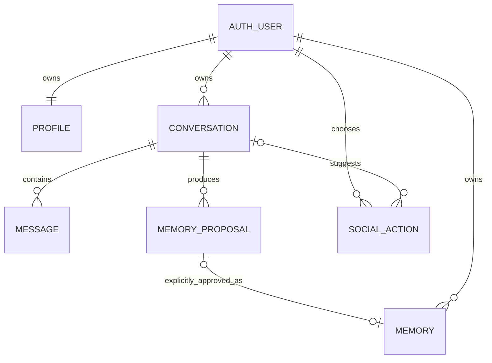

# Data model and ownership

Status: draft preparation. No cloud migration has been applied.

The database represents user choices and app history. Approved memory is an explicit subset of that data; transcripts and model-generated proposals are not implicitly long-term memory. Every operation uses the signed-in user's identity, rather than trusting an owner ID submitted by the browser.

| Table | Purpose | Important fields |
|---|---|---|
| `profiles` | User-editable preferences and a context revision counter | `id = auth.users.id`, `display_name`, `city`, `interests`, `tone`, `memory_revision`, `version` |
| `conversations` | A displayable thread and its current model-context generation | `id`, `user_id`, `title`, `scenario`, `status`, `context_epoch`, `version` |
| `messages` | Append-only, completed user/assistant turns | `conversation_id`, `user_id`, `role`, `content`, `client_request_id`, `context_epoch` |
| `memory_proposals` | Facts suggested for review, never injected as approved memory | `suggested_content`, `status`, `expires_at`, `source_message_id`, `version` |
| `memories` | Facts an authenticated user explicitly approved | `content`, `source_proposal_id`, `approved_at`, `expires_at`, `version` |
| `social_actions` | A suggestion the user can accept, complete, or dismiss | `title`, `description`, `status`, `due_at`, `completed_at`, `version` |

IDs are UUIDs and times are `timestamptz`. Expose camelCase objects at the HTTP boundary while keeping these database column names. Text upper bounds count the full stored value, including padding. Profile interests must be a one-dimensional array of at most 20 nonnull, nonblank strings of at most 60 characters each. API validation must also reject unknown fields and enforce its smaller per-request limits (currently at most 12 interests).

## Ownership and authorization

All app tables have RLS enabled. Unauthenticated `anon` access is revoked. Authenticated users can read only their own rows, and writable columns are granted explicitly. Composite foreign keys pair each referenced ID with `user_id`, so A cannot attach an otherwise A-owned message to B's conversation. Proposal source messages must also belong to the same conversation.

Direct insert into approved `memories` is denied to app clients. Proposal status, social-action status, context epochs, revision counters, ownership IDs, and approval timestamps cannot be updated through ordinary column grants. Narrow SECURITY DEFINER functions set an empty search path, derive the actor from `auth.uid()`, verify ownership, and implement the protected transitions. Treat the migration owner and `service_role` as trusted administration; they can bypass these app-level constraints.

The database cannot prove whether a UI click was a human's intention. The server must expose memory approval only as a distinct authenticated user action, and must never give the language model this function as a tool or execute model output as SQL.

## Memory lifecycle

1. A chat response may produce a pending proposal with a source message. It is shown separately from saved memory. The initial default review window is 24 hours and is open to revision.
2. `accept_memory_proposal(p_proposal_id, p_content, p_expires_at, p_expected_version)` locks the owned proposal and checks it is pending and unexpired. It checks proposal and requested memory expiry against the actual decision time after acquiring the lock, rather than transaction-start `now()`, and records that time as `approved_at`. It stores the user-reviewed content and optional memory expiry in one transaction. PostgreSQL distinguishes [wall-clock time from transaction-start time](https://www.postgresql.org/docs/current/functions-datetime.html#FUNCTIONS-DATETIME-CURRENT).
3. Acceptance marks the proposal resolved and clears its duplicate suggested text. Retrying the same acceptance returns the existing memory. If the user later deletes that memory, retrying the old acceptance does not recreate it.
4. `reject_memory_proposal(p_proposal_id, p_expected_version)` resolves the proposal and clears its suggested text. Expired pending proposals remain stored until a cleanup policy is implemented, but must not be presented as actionable suggestions.
5. Users edit approved content/expiry or delete the approved row. The UI must show success only after the database confirms the write. Delete the corresponding pending UI state as well.

Retrieval must always constrain approved memories by owner and `(expires_at is null or expires_at > current time)`. An expired row is not eligible context even if physical cleanup has not run. A separate memory store or vector database is unnecessary for this initial scope.

## Context invalidation and expiry

Explicit approved-memory insert/edit/delete increments `profiles.memory_revision` and every owned conversation's `context_epoch` in the same transaction. Editing a profile's display name, city, interests, or tone does the same; a cleared profile fact must not survive through old transcript context. Messages from old epochs remain displayable history but must not be sent automatically to Claude again. Message insertion validates the current epoch so an old streaming request cannot append an assistant response into a newer generation.

The chat server must implement this contract:

1. Fetch the current conversation epoch, memory revision, and eligible approved-memory records on each turn. Use short-lived request context, not a permanent provider conversation or a process-wide user-memory cache.
2. Build context only from current-epoch transcript turns and the currently eligible memories. Record the active-memory IDs and the earliest future `expires_at` as `contextValidUntil` for that request.
3. If previously used memories have expired, call `reset_conversation_context(p_conversation_id, p_expected_epoch)` before continuing, then rebuild context. A persisted active-memory fingerprint/deadline or a conservative reset at every turn is needed to detect expiry across server restarts. The schema does not currently persist that fingerprint; this remains an integration task.
4. Before emitting or persisting a completed assistant turn, recheck the epoch, revision, and expiry deadline. Abort/cancel and ask the user to retry if the request became stale. For streamed responses, stop further chunks on invalidation; already displayed text cannot be recalled.

Starting a new context must actually stop reusing old transcript content. Removing a saved memory from a system prompt while resending an old message containing the same fact does not satisfy this behavior. A user may reintroduce a fact in a new message; that still does not approve it for long-term memory.

Deleting a memory does not erase previous screen output, retained transcripts, backups, or provider logs. The product must distinguish removal from future companion memory from broader data deletion. Physical retention and account deletion need a separate reviewed policy.

## Social-action lifecycle

Every action begins `proposed`. The authenticated user calls `transition_social_action(p_action_id, p_status, p_expected_version)` for `proposed -> accepted`, `proposed -> dismissed`, `accepted -> completed`, or `accepted -> dismissed`. The server does not mark actions accepted because the model recommended them. Completed/dismissed states are terminal in this draft; a later revision can add reopening.

An action can be edited or deleted by its owner. The database sets `completed_at` only for the completed state. A completed checkbox records the user's report; it does not independently verify that an interaction occurred.

## Retries and concurrency

- Each submitted chat turn uses one client-generated UUID. The user message and completed assistant message share `client_request_id`, and uniqueness on `(conversation_id, client_request_id, role)` prevents duplicate rows on retry.
- That constraint alone does not prevent two concurrent requests from both calling Claude. The API still needs a per-turn claim/lock or an equivalent in-flight request policy before billable calls. A durable `chat_turns` state machine can be added when the chat route is implemented; it is intentionally not hidden inside this draft.
- Mutable rows expose `version`. Update requests compare `expectedVersion` and return a conflict rather than silently overwriting another tab's edits. Map it to the `p_expected_version` argument for proposal/action RPCs; those RPCs reject a null or missing expected version. Ordinary profile/memory edits need a version-conditioned API update.
- RPC decisions lock the target row; memory acceptance and the resulting context invalidation are atomic. SQL errors `40001` mean stale state and require a reload/retry, not an automatic repetition of a billable call.
- Source conversation deletion removes its messages and proposals. Already approved memories and social actions survive with their source reference detached. Deleting the Auth user through a trusted account-deletion flow cascades through all owned application rows.

## Open implementation decisions

- Guest identities for the demo versus permanent sign-in; guest data cannot be recovered on another device without linking an identity.
- Transcript retention, deletion UX, cleanup scheduling, and deletion of external provider data where supported.
- Persisted context fingerprint/expiry boundary and the UI explanation when a memory change starts a fresh conversation context.
- A durable per-turn claim for duplicate-request suppression and the handling of interrupted streams.
- Whether a user can add a memory manually without first creating a proposal; the current draft deliberately exposes approval of proposals only.

The schema has no diagnostic labels, clinical risk scores, or claims of comprehensive crisis detection. Product boundaries and any separate support flow belong in reviewed application behavior.

Primary references: [Supabase RLS](https://supabase.com/docs/guides/database/postgres/row-level-security), [database functions and execution privileges](https://supabase.com/docs/guides/database/functions), and [PostgreSQL foreign-key constraints](https://www.postgresql.org/docs/current/ddl-constraints.html).
