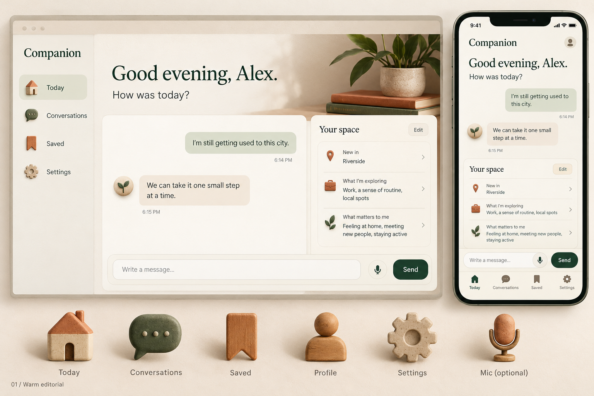
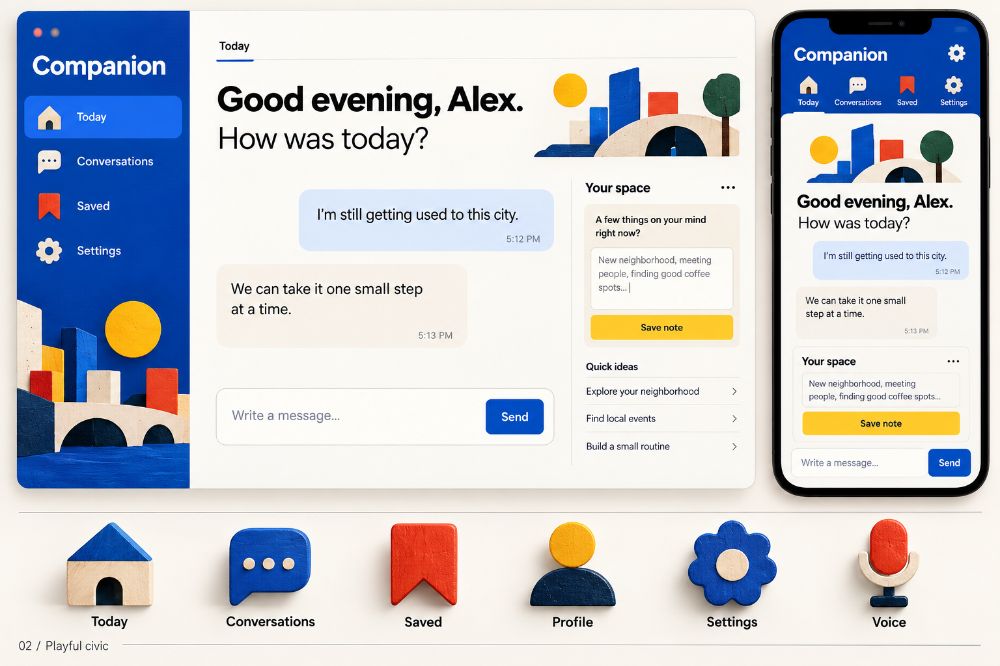
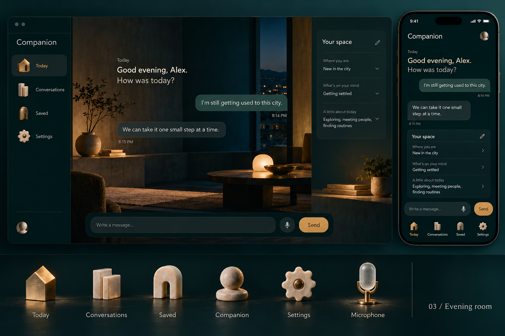
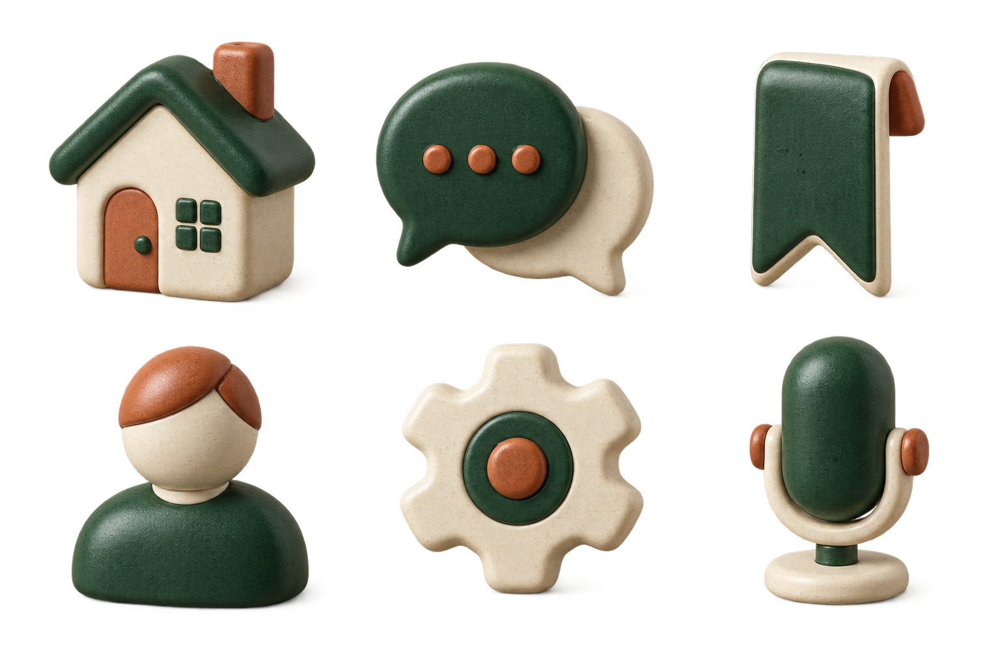

# Visual exploration

Status: design exploration before application styling. Product features, brand,
and visual direction remain open. No concept board is an approved specification.

## Required design workflow before frontend implementation

**Checkpoint status: DECIDED for the chat-screen scope below (October 31, 2026).**

October 31 preference: the optional mascot should be a cute, whimsical animal or
creature rather than a realistic human. This guides future image-generated
character options; the actual mascot, animation, and app style still await the
collaborator discussion and selection below. Mascot implementation is currently
deferred while Deepgram input and Tavus audio-only output architecture are
prepared. This does not select a character or authorize video-conversation UI.

When frontend work is about to begin, the agent must bring up the style
discussion with the collaborator requesting or leading that work. **Any project
collaborator can make the design decision; approval from the original project
owner is not required.**

1. Discuss the intended screens, mood, and current scope with that collaborator.
   Revisit the three generated concepts below and the raster icon study, keeping
   feature content mutable.
2. Use the image-generation model to design app mockups and visual directions
   informed by compatible references from [the 100 design masters](design-masters.md).
   This requirement covers the app screens and layouts as well as custom icons.
   Existing generated concepts can be selected when they fit; use image
   generation for refinements, combinations, or new directions the collaborator
   wants to explore. Save new outputs and their prompts in this directory.
3. Present the generated designs and have that collaborator choose the direction
   for the agreed scope. An agent must not silently choose a style and implement
   it directly in code. Its recommendation alone is not a decision.
4. Record the deciding collaborator, generated concept(s), decision, scope, and
   date below, and update the root README checkpoint before implementing
   frontend screens, layouts, visual components, or styling.

Backend and nonvisual preparation may continue while frontend implementation
awaits a collaborator's decision. A recorded decision satisfies the checkpoint
for its scope; repeat the discussion when a later task changes that direction
or the collaborator requests it. Implement the selected design with accessible
HTML/CSS and real controls; image generation supplies the visual design and
raster artwork.

### Current decision: Warm hearth (supersedes Candid minimal for the app)

| Field | Current value |
| --- | --- |
| Status | Decided (scoped) |
| Deciding collaborator | Neeraj Kumar, with feedback from Raegen (layout that makes core features obvious, more color) and testers (cozier, less stark dark mode) |
| Selected concept | HTML preview "Candid Warm Hearth" (private artifact, 2026-10-31): oat and cream surfaces, cocoa text, terracotta actions, sage for memories, honey for the weekly small step; rounder bubbles and pill buttons; Geist type kept |
| Layout | Desktop: labeled left rail (chat, memories with a count, conversations), chat in the center, "what Candid remembers" panel on the right. Memory suggestions appear inside the chat as sage cards right after the reply they came from; the weekly small step is its own honey card. Phone: full-screen chat with bottom tabs for chat, memories (count), and history |
| Dark mode | Follows the device setting with a warm "evening" palette (deep cocoa, cream text, amber and terracotta accents) instead of near-black |
| Image generation | Not used: no image-generation tool in this session; the collaborator approved the HTML preview. Illustrations and the mascot still need image-generated artwork |
| Approved scope | All signed-in and signed-out app screens on desktop and phone |
| Decision date | 2026-10-31 |

### Previous decision: Candid minimal (superseded by Warm hearth)

| Field | Current value |
| --- | --- |
| Status | Decided (scoped) |
| Deciding collaborator | Neeraj Kumar |
| Reference | The design language of [skillsync.com](https://skillsync.com/), used as inspiration only: no logo, copy, illustrations, or page structure copied |
| Selected concept | HTML preview "Candid Design Preview" (private artifact, 2026-10-31): off-white page, near-black ink, one orange accent; Geist and Geist Mono; large lowercase headlines with a gray second line; small uppercase mono labels; centered frame with hairline rules; flat cards with thin borders; matching dark theme |
| Image generation | Not used: no image-generation tool was available in the session. The collaborator approved the HTML preview instead. Product illustrations and the deferred mascot still need image-generated raster artwork before they appear |
| Approved scope | Chat app: welcome and age check, under-18 and setup notices, kill-switch notice, chat screen, conversation sidebar, and memory panel. A public landing page is proposed in the same preview and awaits a separate go-ahead |
| Decision date | 2026-10-31 |

The 01 / Warm editorial record below is kept for history; it no longer applies to the app.

### Collaborator design decision record

| Field | Current value |
| --- | --- |
| Status | Decided (scoped) |
| Deciding collaborator | Neeraj Kumar |
| Selected generated concept(s) | [01 / Warm editorial](concepts/01-warm-editorial.png) |
| Design decision / refinements | Use the warm editorial palette and hierarchy: ivory surfaces, forest-green primary action, sage user bubbles, warm beige assistant bubbles, terracotta accent, serif headings over a sans-serif body. Chat column with a "Your space" side panel and a bottom message composer. No refinement images were generated: this session had no image-generation tool. Until individual raster icons are generated, the UI uses text labels only, with no SVG, emoji, or CSS-drawn icon substitutes. |
| Approved scope | Chat screen: anonymous session start, conversation thread, message composer, crisis-resource view, "Your space" panel with memory proposals (review/edit/save/dismiss) and saved memories (delete), and sign-out. Other screens (Conversations, Saved, Settings, profile, mobile tab bar) are not yet in scope. |
| Decision date | 2026-10-31 |
| Scope extension | 2026-10-31, Neeraj Kumar (from user feedback): a "Your conversations" list in the chat sidebar with open and per-conversation delete, and a notice that conversations are saved by default. Same 01 direction; text labels only. |

The user requested a catalog of 100 design masters, image-generated app concepts
informed by those references, and generated raster artwork for custom app icons
instead of SVG/vector-library icons.

## Reference catalog

See [100 design references](design-masters.md). The catalog is a curated pool of
principles, not an objective ranking or a recipe to combine 100 styles. Each
concept selects a small compatible cluster and creates original work.

## Directions

| Direction | Principles | Visual treatment |
| --- | --- | --- |
| 01 / Warm editorial | Human-scaled material warmth; editorial order; clear symbols | Ivory, forest green, restrained terracotta; serif/sans hierarchy; tactile ceramic icons |
| 02 / Playful civic | Wayfinding; modular rhythm; bold clarity; human play | Warm white, cobalt, tomato/yellow accents; strong grotesk type; dimensional wood/paper icons |
| 03 / Evening room | Architectural proportion; quiet light; restrained objects | Ink teal, warm ivory, amber; spacious dark surfaces; ceramic/glass/brass raster icons |

Desktop and mobile concepts use comparable sample content so the visual systems
can be judged independently of feature choices. Text in generated mockups is
illustrative; the implemented app will use real accessible HTML text and controls.

## Generated concepts

All four outputs were generated with the built-in image-generation tool and saved
as 1536 x 1024 PNG files. The icon-family study has an actual alpha channel with
fully transparent background pixels; the app boards are opaque presentation images.

### 01 / Warm editorial

Selected reference principles: Charles and Ray Eames, Alvar and Aino Aalto,
Dieter Rams, Susan Kare, and Massimo and Lella Vignelli. A warm, tactile direction
with an editorial reading hierarchy and restrained green/terracotta accents.

### 02 / Playful civic

Selected reference principles: Otl Aicher, Alexander Girard, Saul and Elaine Bass,
Lance Wyman, Wim Crouwel, and Margaret Calvert. Bold navigation and dimensional
wood/paper artwork give this direction a more energetic public-facing character.

### 03 / Evening room

Selected reference principles: Luis Barragan, Tadao Ando, Isamu Noguchi, Charlotte
Perriand, Eileen Gray, and Kenya Hara. A quieter dark palette uses architectural
light and ceramic/glass/brass materials. Its more abstract icon metaphors need
further recognition testing before production.

### Raster icon-family study

Six original ceramic icon concepts: home, conversation, saved item, profile,
settings, and optional microphone input. Microphone artwork represents dictation,
not a commitment to voice responses. This separate sheet explores the warm
editorial material family and preserves transparency around the objects.

Direction 01 was selected for the chat-screen scope recorded above. The boards
remain visual proposals for everything outside that scope. Their sample modules, text, decorative imagery, and icons
can be changed or removed as the product evolves.

## Asset policy

- Use original image-generated raster artwork for custom icons and illustrative
  assets, following the user's preference. Do not substitute SVG icon packs,
  icon fonts, emoji, or CSS-drawn stand-ins for those assets.
- Keep labels beside navigation icons. Artwork does not replace accessible names,
  keyboard behavior, sufficient contrast, or appropriate tap targets.
- Generate production icons individually at suitable resolution with genuine
  transparency after the direction is selected. The family sheet is a visual
  study, not a claim of ready-to-use individual icon exports.
- Implement layout, text, form controls, focus states, and responsive behavior in
  HTML/CSS. Do not ship a generated screenshot as the interface.
- Save project-bound generated images in this repository. Preserve prompts and
  distinguish generated concepts from any later manually implemented screens.

Generation uses the built-in image-generation tool. The complete prompts are in
[generation-prompts.md](generation-prompts.md). The app's current CSS and components
are not restyled as part of this exploration.
