# Optional speech architecture

Status, October 31, 2026: prepare Deepgram for optional speech input and Tavus
for optional audio-only output. Keep Claude as the app's conversation model.
Gemini is deferred while credits are pending; mascot work is deferred. Camera
capture and video conversations are outside scope. Both providers default off.

## Implemented preparation

- `src/lib/voice/input.ts`: provider/session interfaces, Deepgram Listen v1 mono
  transcript normalization, and an editable in-memory dictation buffer.
- `src/lib/voice/server.ts`: isolated server-only configuration; disabled voice
  needs no Deepgram key and does not affect text, Anthropic, or Supabase setup.
- `src/lib/tavus/`: independent audio-output contracts, server configuration,
  and session/playback ports; see [Tavus preparation](tavus.md).
- Voice, Tavus, and runtime checks cover transcript finality, bounds, Unicode,
  editing, cancellation, private-room contracts, and safe configuration errors.

Actual audio capture, temporary browser credentials, streaming transport, mascot
assets/animation, and speech output remain implementation work. Enabling the
configuration flag alone does not implement these features. No speech SDK is
installed or live connection created, and no Vapi key or assistant ID is used.

## Separate capabilities

| Capability | Direction | Status |
| --- | --- | --- |
| Speech input | Deepgram standalone speech-to-text | Interfaces and transcript adapter prepared; transport absent |
| Conversation and saved data | App backend, Claude, Supabase | See root README and milestone report for current progress |
| Audio output | Optional Tavus supplied-text Echo in audio-only sessions | Contracts/ports prepared; combined mode and live transport unverified |
| Mascot presentation | Optional image-generated animal/creature artwork | Deferred; design discussion and assets pending |

The providers are separate capabilities, not competing conversation models.
Deepgram handles microphone transcription; the app/Claude produces the reply.
Tavus is intended to play only supplied, backend-approved reply text. The Tavus
Echo plus audio-only combination still needs account-level validation; its full
pipeline must not be enabled as an unannounced fallback. Mascot details do not
block either interface.

## Planned input path

```mermaid
flowchart LR
  Mic[Explicit microphone capture] -. future WebSocket .-> STT[Deepgram STT]
  STT -. Results events .-> Draft[Editable local draft]
  Draft --> Review[Person reviews and presses Send]
  Review --> API[Authenticated app chat]
  API --> Claude[Claude response]
  Claude -. validated reply text .-> Tavus[Optional Tavus audio-only Echo]
  Tavus -. future receive-only RTC .-> Playback[Audio playback, no camera]
```

Use a mono microphone stream, not speaker/system audio. The adapter accepts
Listen v1 `Results` with `channel_index: [0, 1]`, reads the first alternative,
and uses `is_final` for finalized segments. `speech_final` marks a pause or
utterance boundary; using it alone can lose preceding finalized segments.
Flux and multichannel streams require a separate adapter. Transcription does
not authenticate the speaker. See [Deepgram transcript finality](https://developers.deepgram.com/docs/understand-endpointing-interim-results).

Partial text replaces the preview; final segments append to committed draft
text. An empty interim or final correction clears only the provisional preview,
preserving previously committed words. The combined limit is 1,000 UTF-16 code
units, matching the chat schema.
Repeated phrases are legitimate; the buffer does not guess whether identical
finals are duplicates. The future transport must prevent replay. Invalid or
excessive updates preserve the previous draft. Text is not auto-submitted,
saved, logged, or sent to Claude by this module.

Use one fresh buffer per capture session. Abort clears it and ignores late
events. Stop and detach capture before normal editing. A future transport must
guard callbacks by session generation; `reset()` is only a local draft reset.

## Configuration and activation

| Setting | Scope | Default |
| --- | --- | --- |
| `VOICE_INPUT_ENABLED` | Server flag, `true` or `false` | `false` |
| `DEEPGRAM_API_KEY` | Permanent key, server only | Unset |

The getter validates configuration only when enabled; it does not verify the key
with Deepgram. Never expose its result or put the permanent key in a
`NEXT_PUBLIC_*` variable. Leave the flag false and the key blank for text work.
The scaffold works with both providers disabled and no service keys. Optional
Tavus settings are listed in [its activation guide](tavus.md). Vapi is retired.

Before activating speech:

1. Configure Deepgram and store the key in ignored `.env.local` and Vercel server
   settings. Confirm project limits and retention for the selected service.
2. Add a verified-user credential/bootstrap route with same-origin checks,
   per-user budgets, concurrent-session limits, and expiry. Use a short-lived
   browser credential supported by Deepgram; validate its scope/lifetime before
   exposing it. Connect audio directly to Deepgram rather than putting a
   long-lived audio socket through a Vercel request.
3. Implement lazy microphone capture after a user gesture and permission, using
   HTTPS. Set encoding/sample rate to match the captured audio. Stop tracks,
   release sockets/listeners, and cancel pending starts on abort/error/unmount.
   Flush final speech before normal stop and test late/replayed events.
4. Follow the [collaborator style workflow](design/README.md) before microphone
   controls. Keep dictation editable and require Send; validate it again at the
   chat API. Mascot design is deferred and does not gate backend preparation.
5. Activate Tavus output only after its separate mode, ownership, and cleanup
   checks. Add playback cancellation and avoid feeding output audio back into
   the microphone. Select one output provider per reply.

No paid calls, new account configuration, audio retention, mascot rendering, or
frontend design is performed by the current scaffold. Browser/device integration
checks remain necessary when actual transport is implemented.
