# Optional speech and mascot architecture

Status, October 31, 2026: Deepgram is selected for optional speech input. The
owner dropped Vapi and prefers a cute, whimsical animal/creature mascot. Tavus
is not required for that direction. Voice remains disabled by default.

## Implemented preparation

- `src/lib/voice/input.ts`: provider/session interfaces, Deepgram Listen v1 mono
  transcript normalization, and an editable in-memory dictation buffer.
- `src/lib/voice/server.ts`: isolated server-only configuration; disabled voice
  needs no Deepgram key and does not affect text, Anthropic, or Supabase setup.
- Voice and runtime checks cover transcript finality, bounds, Unicode, editing,
  cancellation, and safe configuration errors.

Actual audio capture, temporary browser credentials, streaming transport, mascot
assets/animation, and speech output remain implementation work. Enabling the
configuration flag alone does not implement these features. No speech SDK is
installed or live connection created, and no Vapi key or assistant ID is used.

## Separate capabilities

| Capability | Direction | Status |
| --- | --- | --- |
| Speech input | Deepgram standalone speech-to-text | Interfaces and transcript adapter prepared; transport absent |
| Conversation and saved data | App backend, Claude, Supabase | See root README and milestone report for current progress |
| Mascot presentation | Image-generated animal/creature artwork, animated in the app | Preference recorded; design discussion and assets pending |
| Spoken replies | Optional Deepgram text-to-speech if selected | Separate decision; no synthesis/playback code |

The mascot should observe presentation states such as idle, listening, thinking,
and speaking. It does not own conversation history, authentication, or approved
memory. Basic state animation does not require a video-avatar service; detailed
mouth synchronization is a separate implementation choice.

Tavus's current Face documentation supports human-shaped likenesses, including
cartoon styles, but excludes animals and other non-human mascots. If the team
later chooses a human-shaped conversational video avatar, revisit Tavus as an
alternative pipeline. See [supported faces](https://docs.tavus.io/sections/faces/overview).

## Planned input path

```mermaid
flowchart LR
  Mic[Explicit microphone capture] -. future WebSocket .-> STT[Deepgram STT]
  STT -. Results events .-> Draft[Editable local draft]
  Draft --> Review[Person reviews and presses Send]
  Review --> API[Authenticated app chat]
  API --> Claude[Claude response]
  Claude -. optional future synthesis .-> TTS[Deepgram TTS]
  TTS -. audio playback state .-> Mascot[App-rendered mascot]
```

Use a mono microphone stream, not speaker/system audio. The adapter accepts
Listen v1 `Results` with `channel_index: [0, 1]`, reads the first alternative,
and uses `is_final` for finalized segments. `speech_final` marks a pause or
utterance boundary; using it alone can lose preceding finalized segments.
Flux and multichannel streams require a separate adapter. Transcription does
not authenticate the speaker. See [Deepgram transcript finality](https://developers.deepgram.com/docs/understand-endpointing-interim-results).

Partial text replaces the preview; final segments append to committed draft
text. The combined limit is 4,000 UTF-16 code units, matching the chat schema.
Repeated phrases are legitimate; the buffer does not guess whether identical
finals are duplicates. The future transport must prevent replay. Invalid or
excessive updates preserve the previous draft. Text is not auto-submitted,
saved, logged, or sent to Claude by this module.

Use one fresh buffer per capture session. Abort clears it and ignores late
events. Stop and detach capture before normal editing. A future transport must
guard callbacks by session generation; `reset()` is only a local draft reset.

## Configuration and activation

| Setting | Scope | Default |
| --- | --- | --- |
| `VOICE_INPUT_ENABLED` | Server flag, `true` or `false` | `false` |
| `DEEPGRAM_API_KEY` | Permanent key, server only | Unset |

The getter validates configuration only when enabled; it does not verify the key
with Deepgram. Never expose its result or put the permanent key in a
`NEXT_PUBLIC_*` variable. Leave the flag false and the key blank for text work.
No Vapi or Tavus account setup is needed for this architecture.

Before activating speech:

1. Configure Deepgram and store the key in ignored `.env.local` and Vercel server
   settings. Confirm project limits and retention for the selected service.
2. Add a verified-user credential/bootstrap route with same-origin checks,
   per-user budgets, concurrent-session limits, and expiry. Use a short-lived
   browser credential supported by Deepgram; validate its scope/lifetime before
   exposing it. Connect audio directly to Deepgram rather than putting a
   long-lived audio socket through a Vercel request.
3. Implement lazy microphone capture after a user gesture and permission, using
   HTTPS. Set encoding/sample rate to match the captured audio. Stop tracks,
   release sockets/listeners, and cancel pending starts on abort/error/unmount.
   Flush final speech before normal stop and test late/replayed events.
4. Follow the [collaborator style workflow](design/README.md), generate original
   raster mascot options, and select the character/animation before UI work.
   Keep dictation editable and require Send; validate it again at the chat API.
5. If spoken replies are selected, add bounded text-to-speech and playback
   cancellation separately. Avoid feeding playback back into microphone input.
   See [Deepgram streaming TTS](https://developers.deepgram.com/docs/streaming-text-to-speech).

No paid calls, new account configuration, audio retention, mascot rendering, or
frontend design is performed by the current scaffold. Browser/device integration
checks remain necessary when actual transport is implemented.
